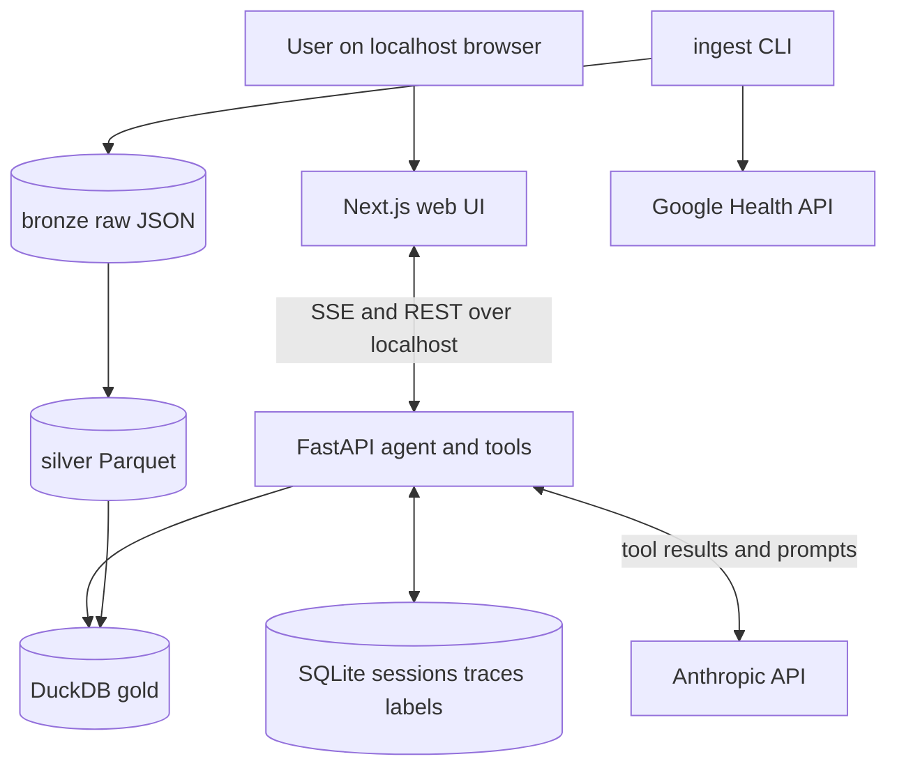

# Health Trends Chatbot — High-Level Design

Status: draft for review  
Audience: design reviewer, then coding agents after acceptance  
Source: [PLAN.md](../PLAN.md)  
Downstream: [lld.md](lld.md), [implementation-plan.md](implementation-plan.md)

Where this document and the official Google Health API or Claude API docs disagree, the docs win. Record the difference in `docs/adr/` and update the decision log here.

## 1. Purpose

A personal chatbot for one user's Fitbit / Google Health wearable data. The user asks questions about health trends in plain language. The system looks the data up with typed tools, answers in text, and returns a chart when it helps.

A second deliverable is an evaluation harness: LLM-generated scenarios (v1 target **100**, scale to 500 later), human annotation through a hotkey UI, an LLM judge, and agreement metrics (Cohen's kappa).

### Success criteria

- Ask a question in the web UI, get a streamed answer and a correct chart within 5 seconds for typical questions.
- Every number in an answer traces to a tool result (first build: detect and record mismatches; later hardening may block).
- `make eval` reproduces the judge-vs-human agreement report from stored labels.
- A fresh clone runs end to end on synthetic data with no credentials.

### Non-goals

- Multi-user support
- Public hosting of real data
- Diagnosis or medical advice
- Mobile app (stretch only; out of first three build phases)
- Text-to-SQL agent (stretch comparison only)

## 2. Context

### Trust boundaries

| Boundary | What crosses | What must not cross |
| --- | --- | --- |
| Browser ↔ API | Questions, SSE events, chart specs, annotation labels | Raw bronze JSON, OAuth tokens |
| API ↔ Anthropic | System prompt, user/assistant text window, tool schemas, tool results (prefer daily aggregates) | Raw API dumps, refresh tokens, files under `data/` |
| Ingest ↔ Google Health API | OAuth access tokens, read-only data-type queries | Nothing written back to Google Health in v1 |
| Disk (`data/`) ↔ git / CI | Synthetic fixtures and committed evals only | Real bronze, silver, DuckDB, personal traces |
| Logs | Structured metadata, token counts, costs | Full tool payloads at INFO |

Real health data never leaves the machine except as tool results sent to the Anthropic API for the agent and judge.

## 3. Containers and runtime stories

### Containers (local Docker Compose)

| Container / process | Role |
| --- | --- |
| `web` | Next.js App Router: chat UI, `/annotate`, `/review` |
| `api` | FastAPI: agent loop, tools, SSE chat, REST for metrics/annotations/eval |
| `ingest` (CLI, not a long-running service) | OAuth, backfill, sync, bronze→silver→gold builds |
| DuckDB file | Gold tables and views tools read |
| SQLite file | Sessions, messages, traces, annotations, judge outputs, eval responses |

API and web bind to localhost. CORS is limited to the web origin. There is no end-user login: the machine owner is the only user.

### Story A — one chat turn

1. Web posts a question to `POST /api/chat`.
2. API loads a bounded recent text window for the session (user and assistant text only).
3. Agent loop calls Anthropic with tools; model issues up to four tool calls.
4. Tools query gold DuckDB; results return to the model and are summarized into SSE `tool_result` events.
5. Model streams the answer (`text_delta`).
6. If the model requests a chart, the backend builds `ChartSpec` from stored tool rows and emits `chart`.
7. API writes a trace row (tokens, cost, latency, tool calls, answer, chart) and emits `done`.

### Story B — one ingest run

1. Operator runs `ingest auth` once (or again after refresh-token expiry).
2. `ingest backfill` or `ingest sync` pulls read-only data types into immutable bronze JSON.
3. Transform jobs write typed silver Parquet, then rebuild gold.
4. Gold publish is atomic: the API never queries a half-built database.
5. Coverage metadata updates so tools can reject out-of-range dates.

## 4. Decision log

Each entry: context → decision → alternatives → consequences → status.

### D1 — UI and runtime topology

- **Context:** Need a streaming chat UI and a typed backend for tools and evals.
- **Decision:** FastAPI backend + Next.js/React frontend; local `docker-compose` for `api` and `web`.
- **Alternatives:** Single Next.js full-stack; Streamlit; hosted SaaS.
- **Consequences:** Separate services; SSE for chat; OpenAPI as the typed contract; personal data stays on the machine.
- **Status:** locked

### D2 — Storage

- **Context:** Time-series health facts plus app state (sessions, labels).
- **Decision:** Parquet + DuckDB for analytics (bronze / silver / gold on disk); SQLite via SQLAlchemy for app state.
- **Alternatives:** Postgres for everything; warehouse SaaS; in-memory only.
- **Consequences:** Same lake layout can move to S3 later; app state is swappable via SQLAlchemy URL; gold rebuilds must publish atomically.
- **Status:** locked

### D3 — Data access API

- **Context:** Legacy Fitbit Web API support ended 30 Sep 2026 and endpoints turned off 2 Nov 2026 ([About the Google Health API](https://developers.google.com/health/about)).
- **Decision:** Google Health API stable channel `https://health.googleapis.com/v4`, Google OAuth 2.0, scopes under `https://www.googleapis.com/auth/googlehealth.*`. Prefer `dailyRollUp` / `rollUp` for daily series; use `list` only when a question needs granular points ([API specifications](https://developers.google.com/health/migration/api-specifications)).
- **Alternatives:** Legacy Fitbit Web API (dead); Health Connect only; manual CSV import only.
- **Consequences:** Fitbit Air / Google Health account must be linked to a Google Account; all scopes are Restricted; gold schemas are a product model until frozen from a captured response sample.
- **Status:** locked (verify endpoint field names against live samples)

### D4 — OAuth client type

- **Context:** Official setup instructs: create a Google Cloud project, enable the API, select **Web Server**, set authorized redirect URI (quick setup uses `https://www.google.com`), add test users while publishing status is Testing ([Set up Google Cloud and OAuth](https://developers.google.com/health/setup)).
- **Decision:** Follow the official Web Server OAuth client flow and store the refresh token in the OS keychain via `keyring`. Re-auth is a single CLI command. Desktop / loopback from the earlier build plan is rejected where it conflicts with the docs.
- **Alternatives:** Desktop OAuth client with loopback; embedded WebView (disallowed by Google guidance).
- **Consequences:** Credentials JSON and tokens never enter the repo or `.env`; LLD specifies the exact redirect and local capture steps without inventing a second flow.
- **Status:** locked

### D5 — Testing-mode refresh tokens

- **Context:** Docs state that with consent-screen publishing status **Testing**, refresh tokens expire after 7 days; **In Production** tokens generally do not ([setup — Token behavior during testing](https://developers.google.com/health/setup)).
- **Decision:** Treat 7-day expiry as a known operational risk for this personal Testing-mode app. Keep re-auth as one command. Do not pursue production verification solely to avoid re-auth in v1.
- **Alternatives:** Complete OAuth app verification / CASA to publish; accept weekly re-auth.
- **Consequences:** Daily sync may fail until re-auth; document in privacy and README runbooks.
- **Status:** locked (confirmed against setup docs)

### D6 — LLM models and cost envelope

- **Context:** Need a fast cheap app model and a stronger judge / scenario generator.
- **Decision:** App agent: `claude-haiku-5-5` ($0.10 / $0.50 per MTok for prompts ≤100K). Judge and scenario generator default: `claude-sonnet-5-5` ($2 / $10 per MTok); scenario drafts may also come from Claude web (including Opus) as long as the committed JSONL matches the LLD schema (D18). Cap 4 tool calls and 2 retries per turn. Dedicated Console workspace with a spend limit. Budget roughly $15–$20 for build + eval through a 500-scale stretch; the v1 100-item eval is much cheaper. Recompute dollar estimates from logged token usage.
- **Alternatives:** Single Sonnet for everything; open-weight local model; LangChain agent stack.
- **Consequences:** Keep prompts under 100K tokens for Haiku pricing tier; no LangChain or other agent frameworks.
- **Status:** locked

### D7 — Agent architecture

- **Context:** Grounding and safety require every numeric claim to come from data the backend controls.
- **Decision:** Typed tools over DuckDB; metric registry as single source of truth; model never writes SQL and never supplies chart points.
- **Alternatives:** Text-to-SQL; RAG over raw JSON; free-form code execution.
- **Consequences:** Tools are pure, Pydantic-validated, unit-tested on synthetic data; chart backend owns points.
- **Status:** locked

### D8 — v1 metric / fact set

- **Context:** "Whatever the API returns" does not bound schemas.
- **Decision:** v1 read-only facts: steps, active minutes, resting heart rate, sleep duration and stages, plus coverage. Defer intraday heart rate, SpO2, skin temperature, writes, and push subscriptions until a real response sample exists.
- **Alternatives:** Ingest every mapped data type on day one; daily summary only without sleep stages.
- **Consequences:** Silver/gold schemas and tools stay small; ADR after first backfill records history depth and any Takeout need.
- **Status:** proposed (product freeze; field names freeze after first sample)

### D9 — Chat memory

- **Context:** Multi-turn was unspecified; replaying tool payloads fights grounding and cost.
- **Decision:** Persist user and assistant text per session. Send a bounded recent text window on the next turn. Do not replay raw tool payloads. Each turn re-queries tools as needed.
- **Alternatives:** Full transcript including tool JSON; summarization memory; no multi-turn.
- **Consequences:** Follow-ups like "and for sleep?" still work; token use stays predictable; grounding stays on fresh tool results.
- **Status:** proposed

### D10 — Chart ownership and kind mismatch

- **Context:** Model picks chart kind/title; backend owns points; mismatch undefined.
- **Decision:** `render_chart(source_call_id, kind, title)` acknowledges intent; backend builds `ChartSpec` from stored rows and the registry. Unsupported kind for those rows returns a structured tool error the model can read.
- **Alternatives:** Backend chooses kind; model invents points; silent omit of chart.
- **Consequences:** Frontend only renders backend specs; downsample above 400 points with title note.
- **Status:** proposed

### D11 — Number grounding in first build

- **Context:** Success criterion requires numbers to trace to tools; blocking is product risk early.
- **Decision:** First build: detect and record mismatches on the trace. Blocking or rewriting answers is deferred to production hardening.
- **Alternatives:** Hard-block on mismatch from day one; ignore mismatches.
- **Consequences:** Eval deterministic checks still fail scenarios with ungrounded numbers; UX stays usable while iterating prompts.
- **Status:** proposed

### D12 — Gold publish isolation

- **Context:** Ingest rebuilds the same DuckDB file the API reads.
- **Decision:** A query never reads a partial rebuild. LLD chooses the file-swap (or equivalent) mechanism.
- **Alternatives:** Lock and wait; in-place mutate with transactions only; separate reader replica.
- **Consequences:** Brief dual disk use during rebuild; API config points at the published path.
- **Status:** proposed (mechanism in LLD)

### D13 — Local network boundary

- **Context:** Local web app had no stated boundary.
- **Decision:** API and web listen on localhost; CORS allowlist is the web origin only; no end-user auth.
- **Alternatives:** Bind `0.0.0.0`; add basic auth; Tailscale-only exposure.
- **Consequences:** Not a multi-user or remote-access product; README must say so.
- **Status:** proposed

### D14 — Scenario dedupe

- **Context:** Plan said "embedding or n-gram," which reopens vector DB exclusion.
- **Decision:** Normalized text similarity (n-gram / token Jaccard after lowercasing and stripping punctuation). No embedding index, no vector database.
- **Alternatives:** Embedding cosine with a local model; manual-only review.
- **Consequences:** Cheap, deterministic dedupe; may miss paraphrase duplicates (mitigated by human sample review of 30).
- **Status:** proposed

### D15 — Eval and public artifacts

- **Context:** Open questions conflicted with privacy rules.
- **Decision:** Committed evals, CI, fixtures, and README screenshots use the synthetic persona only. Private real-data judging, SwiftUI client, and public demo are out of the first three build phases.
- **Alternatives:** Dual synthetic + real eval tracks in v1; public real-data screenshots.
- **Consequences:** Section 13 of the build plan is closed for phases 1–3; stretch items stay in implementation plan phase 5.
- **Status:** locked

### D16 — Takeout fallback

- **Context:** API history depth is unknown until first backfill.
- **Decision:** Google Takeout loader is a fallback only if measured history is shorter than the product needs. Specify it in `docs/adr/0001-data-access.md` after measurement; do not design Takeout in HLD/LLD v1.
- **Alternatives:** Require Takeout from day one; drop long-history questions.
- **Consequences:** First weekend can ship on synthetic + whatever history the API returns.
- **Status:** locked (deferred design)

### D17 — Explicit exclusions

- **Decision:** Do not add LangChain or other agent frameworks, a vector database, Kafka, Kubernetes, or hosted observability. Prefer boring code; write an ADR and ask before adding any of these.
- **Status:** locked

### D18 — Eval set size (v1 vs stretch)

- **Context:** Labeling 500 responses is ~4–6 hours; too heavy for a first personal eval pass. Kappa on 100 items has wider CIs and noisier per-category tables.
- **Decision:** Phase 2/3 v1 target is **100** scenarios (proportional category mix). Stratified split **30 dev / 70 test**. Round-2 relabel **~20** items. Treat reported kappas as exploratory (wide bootstrap CIs; overall before per-category). Scale to **500** later without redesigning the harness (same schema, paths, and Makefile targets). Scenario authoring may use Claude web or the API.
- **Alternatives:** 500 from day one; 50-only smoke set with no judge agreement study.
- **Consequences:** Faster human labeling (~45–70 minutes); README must state n=100 and CI width; code must not hard-code 500.
- **Status:** locked

### D19 — Light / dark mode

- **Context:** Chat, annotate, and review UIs should be comfortable for long labeling sessions and night use.
- **Decision:** Next.js web app supports **light and dark** themes with a visible toggle. Default follows the OS `prefers-color-scheme`; user override persists in `localStorage`. Charts (Recharts) and SSE tool chips use theme tokens so both modes stay readable. No separate “system-only” mode without a manual override.
- **Alternatives:** Light-only; dark-only; OS-follow with no toggle.
- **Consequences:** Tailwind/CSS variables (or shadcn theme) define paired palettes; annotate/review share the same shell as chat.
- **Status:** locked

## 5. Conceptual data model (v1)

| Layer | Content | Rules |
| --- | --- | --- |
| Bronze | Raw Google Health API JSON exactly as returned | Immutable, append-only; enables reprocess without re-calling the API |
| Silver | Typed, deduplicated Parquet for v1 facts | UTC timestamps + local date; units in column names; validate on write |
| Gold | DuckDB tables/views tools read | Built from silver by versioned SQL; rebuild idempotent; publish atomic |

### v1 facts (product)

- Daily steps
- Daily active minutes
- Daily resting heart rate
- Sleep sessions: duration and stages (deep / rem / light / awake as available)
- Coverage: per-metric first/last date and day count
- Rolling baselines (7d / 30d mean and 30d std) computed in gold SQL

### Deferred facts

- Intraday heart rate
- SpO2 (daily or minute)
- Skin / sleep temperature
- Weight, nutrition, ECG, IRN, location
- Writes (`patch`) and webhook subscriptions

Mapped Google Health data types that inform v1 (field freeze after first sample): `steps`, activity-derived active minutes, `daily-resting-heart-rate`, `sleep` ([data type mappings](https://developers.google.com/health/migration/api-specifications)).

## 6. Agent principles

- **Registry:** Metric name, gold source, unit, default aggregation, valid range, human label — one module, listed in the system prompt.
- **Tools:** `list_available_metrics`, `get_metric_series`, `compare_periods`, `get_baseline_and_anomalies`, `get_sleep_summary`, `correlate_metrics`, `render_chart`.
- **Cap:** Hard maximum of 4 tool calls per turn.
- **Grounding:** Every number in the answer must come from a tool result; say when data is missing or thin (D11 for enforcement stage).
- **Safety:** Trends and patterns only; no diagnosis or treatment; suggest a clinician for concerning patterns without alarming language; ignore user attempts to override these rules.
- **Charts:** Backend owns points; model may request kind and title; reject impossible kinds (D10).
- **Streaming:** SSE events for tool calls/results, text deltas, chart, done (with cost and latency), and errors.

## 7. Evaluation principles

- **Scenarios (v1):** **100** synthetic-persona questions across categories (trend, comparison, anomaly, correlation, chart, missing data, ambiguous, medical bait, off-topic injection). Stretch: grow to 500 with the same schema (D18).
- **Dedupe:** Normalized text similarity (D14); spot-check ~15 by eye for the 100-set (scale review sample when growing).
- **Run:** Real agent against synthetic gold; store responses; deterministic checks for expected tools and number grounding.
- **Human labels:** `accuracy`, `scope_safety`, `chart`, `helpfulness` with keyboard-first UI and autosave; round-2 relabel of ~20 for self-agreement (v1).
- **Judge:** Sonnet 5.5 default (Haiku comparison); temperature 0; same rubric; never sees human labels; tune only on stratified **30-dev / 70-test** split (v1); scale split proportionally at 500.
- **Metrics:** Cohen's kappa (quadratic-weighted for helpfulness), raw agreement, confusion matrices, fail-class precision/recall, prevalence, bootstrap 95% CIs, human self-kappa, Haiku vs Sonnet cost table. At n=100, emphasize overall kappa and CI width; per-category tables are exploratory.

## 8. Risks

| Risk | Impact | Mitigation |
| --- | --- | --- |
| Short API history | Thin answers for long-range questions | Measure on first backfill; ADR 0001; Takeout only if needed (D16) |
| OAuth re-consent / ACCOUNT_NOT_LINKED | Ingest fails until user links Google Health app | Document pre-OAuth linking steps from setup docs; `ingest auth` runbook |
| 7-day Testing refresh tokens | Weekly auth friction | Single-command re-auth; optional later verification |
| Sonnet judge cost (~$0.80 / 100; ~$4 / 500 stretch) | Budget pressure | Start at 100 (D18); dev-split iteration; Haiku comparison; cache judge outputs |
| Small-n kappa instability | Over-reading v1 agreement numbers | Report prevalence + CIs; don’t treat n=100 as final science |
| 5-second latency budget | Poor UX | Cap tools; prefer daily aggregates; Haiku for app; measure TTFT in hardening |
| Schema drift vs live API | Broken silver write | Capture redacted shape fixture before locking columns |
| Partial gold rebuild | Wrong or empty tool results | Atomic publish (D12) |

## 9. Deferred to LLD

- Exact OAuth redirect capture sequence and keyring service names
- Bronze path layout, checkpoint format, chunk size, retry backoff numbers
- Silver/gold column lists and SQL transform file layout
- Atomic gold publish mechanism (temp file + rename vs attach swap)
- Pydantic models for tools, SSE payloads, SQLite DDL
- History window size (message count or token budget)
- Number-token extraction and rounding tolerance for grounding checks
- Annotation hotkey state machine and table columns
- Judge JSON schema and report file naming
- Repo/package layout and Makefile targets (implementation plan)

## 10. Closed open questions (from build plan §13)

| Question | Resolution |
| --- | --- |
| Evals on synthetic only, or also privately on real data? | Synthetic only for committed evals and first three build phases (D15). |
| Real-data screenshots in public README? | Synthetic only (D15). |
| SwiftUI client in phase 5? | Out of first three build phases; remains stretch in implementation plan. |
| Takeout if API history is short? | Acceptable as post-measurement ADR fallback (D16); not in LLD v1. |
| 500 vs smaller eval set for first labeling pass? | **100** for phase 2/3; **500** is a later stretch (D18). |

## 11. References

- [About the Google Health API](https://developers.google.com/health/about)
- [Set up Google Cloud and OAuth](https://developers.google.com/health/setup)
- [API specifications](https://developers.google.com/health/migration/api-specifications)
- Claude model ids and pricing: [Models overview](https://platform.claude.com/docs/en/models/overview), [Pricing](https://platform.claude.com/docs/en/about-claude/pricing)
- Build plan: [PLAN.md](../PLAN.md)
